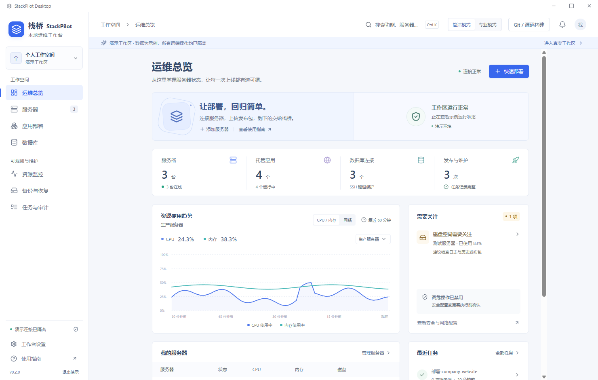
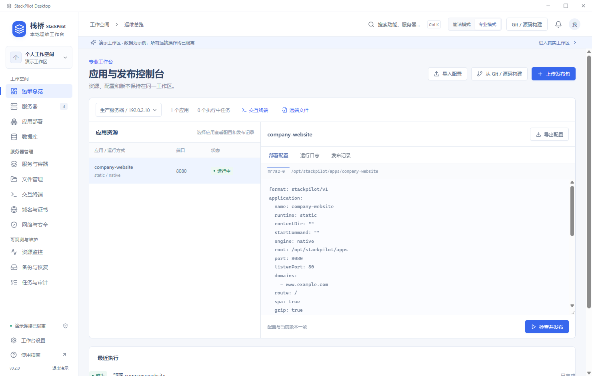

# 栈桥 StackPilot 0.2.0

[源码仓库](https://github.com/clusterstar1229/StackPilot) · [Windows 安装包](http://47.109.34.123:18080/) · [版本记录](CHANGELOG.md)

StackPilot 是面向个人管理数台服务器的 Windows 桌面运维工作台。安装后双击启动，通过 SSH 完成网站托管、应用发布、数据库操作和主机管理。界面默认简体中文、浅色主题。

它把服务器连接、发布包识别、运行配置、执行日志、健康检查和版本回滚放在同一条操作流程中。

## 已实现功能

| 工作内容 | 实际功能 |
|---|---|
| 服务器连接 | 密码、私钥、主机指纹、服务器分组、跳板机、HTTP CONNECT / SOCKS5 代理；SSH 端口留空使用 22，端口映射场景填写实际端口 |
| 前端网站 | dist 文件夹、ZIP、tar/tgz；Nginx、SPA 路由、子路径、资源缓存、Gzip、多域名、API 代理、WebSocket |
| 后端发布 | JAR、WAR、Node.js、Python、Linux 可执行程序、.NET、容器镜像和 Compose；配置入口、环境变量、启动参数、工作目录、内存和 CPU |
| Git 源码部署 | HTTP(S) 仓库、分支或标签、访问 Token、Commit 记录；本机 Docker 构建、镜像归档、SSH 上传和服务器导入运行 |
| 版本管理 | 发布记录、健康检查、失败恢复、历史回滚、蓝绿发布、多实例、复用当前产物修改配置 |
| 数据库 | MySQL/MariaDB、PostgreSQL、Redis、MongoDB、SQLite；连接、查询、浏览、账号与权限、单行编辑、备份、恢复和复制模板 |
| 日常运维 | systemd 服务、容器、文件、进程、端口、磁盘、定时任务、资源曲线、应用检查、任务记录 |
| 域名与证书 | Cloudflare、DNSPod、阿里云 DNS；自动解析、HTTP-01 证书申请和续期、上传证书、HTTPS 跳转 |

## 两种工作方式

**简洁模式**围绕部署步骤组织操作：选择发布包、配置访问、设置运行选项、检查计划、执行发布。发布包检测会给出运行类型、入口和内容目录。



**专业模式**使用应用资源表和配置检查器。选择应用后，可编辑 YAML、读取日志、查看发布历史、导出配置或打开 SSH 交互终端。终端支持多会话、Ctrl+C、方向键、窗口尺寸同步和切页保留。



两张截图使用内置演示工作区的数据。

## 两条部署流程

### 上传成品包

1. 连接目标服务器。
2. 选择 dist、压缩包、JAR、WAR、运行包、镜像或 Compose 项目。
3. 根据识别结果设置目录、端口、域名、代理和启动参数。
4. 查看部署计划，执行上传、配置和健康检查。
5. 在发布记录中查看结果、更新配置或回滚版本。

### 从 Git 或本机源码构建

1. 填写 HTTP(S) 仓库地址及分支，或选择源码文件夹。
2. 检测项目，选择构建方案，填写命令、输出目录和容器端口。
3. 本机 Docker 完成编译和镜像归档。
4. 选择服务器，通过 SSH 上传归档并导入运行。
5. 查看关联的 Commit、构建命令、镜像 ID、产物校验值和发布版本。

源码构建使用本机计算资源，目标服务器负责运行产物。构建需要启动 Docker Desktop；成品包向导直接使用已有发布包。

## 与相关项目的区别

| 项目 | 主要工作方式 | StackPilot 的实现重点 |
|---|---|---|
| [Electerm](https://github.com/electerm/electerm) | 桌面终端、SSH/SFTP 会话和远端文件操作 | 将 SSH 会话接入应用、网站、数据库和发布历史的图形操作流程 |
| [1Panel](https://github.com/1Panel-dev/1Panel) | 部署在服务器上的网站、数据库与主机管理面板 | 控制面运行在 Windows 本机，通过 SSH 管理已有服务器 |
| [Coolify](https://github.com/coollabsio/coolify) / [Dokploy](https://github.com/Dokploy/dokploy) | 服务器端应用平台、Git 发布、多服务和应用模板 | 成品包与源码共用发布工作台；源码在本机编译，再向服务器交付产物 |
| [Kamal](https://github.com/basecamp/kamal) | SSH 与容器的命令行部署流程 | 把发布参数、配置复用、日志、健康检查和回滚做成可视化操作 |
| [CapRover](https://github.com/caprover/caprover) | 服务器端容器应用平台，统一处理应用入口和证书 | 在个人桌面中集中管理成品包、原生服务、容器应用和数据库 |

StackPilot 的产品路线是：**Windows 本地工作区、成品包与源码双入口、本机构建后交付、简洁与专业两种操作方式，以及网站和数据库的统一管理。**

## 0.2.0 的工程增量

- 专业模式改为资源表、YAML 配置、日志和发布记录检查器。
- 增加 xterm / SSH2 真实交互终端。
- 增加 Git 拉取、本机源码检测、构建任务、镜像归档和 SSH 导入链路。
- 增加 12 个构建方案：静态前端、Node.js、Next.js、Nuxt、Maven、Gradle、Python、Go、.NET、PHP、Dockerfile、Compose。
- 增加 YAML 导入/导出，以及复用远端产物修改配置的流程。
- Compose 交付携带服务镜像、相对挂载文件和项目配置。
- 增加正式回归测试、桌面流程测试和源码检查任务。

代码入口与验证记录见 [0.2.0 实现报告](docs/V0.2-REPORT.md)。

## 部署配置

| 项目类型 | 配置入口 |
|---|---|
| React / Vue / Angular 静态输出 | 设置构建输出目录，配置 SPA 路由、子路径和 API 代理 |
| Next.js / Nuxt SSR | 选择对应服务端构建方案，设置启动命令与端口 |
| Java | 原生成品包可指定 Java Home、JVM 参数；源码方案默认 Java 21 |
| Python | 选择依赖安装命令及 ASGI / WSGI 模块；Django 可从 manage.py 识别模块名 |
| Go / .NET | Go 默认生成 Linux 可执行文件；.NET 默认版本为 8，填写实际 DLL 名称 |
| PHP / Laravel | PHP 8.3 / Apache；Laravel 使用 public 根目录，并配置 APP_KEY、存储和迁移命令 |
| pnpm / yarn / monorepo | 设置仓库子目录、构建命令、输出目录，或使用项目 Dockerfile |
| LFS / 子模块 | 在本机检出完整项目后，从源码文件夹入口构建 |
| ARM / GPU / 系统库依赖 | 使用项目 Dockerfile 设置架构、运行环境和依赖 |

服务器环境通过 `/etc/os-release`、apt/dnf/yum、systemd、Nginx 和容器工具探测。镜像归档单文件上限为 2GB。蓝绿备用端口使用基础端口 +100。

数据库 SQL 工作台执行查询，单行编辑按唯一键定位。关系型数据库和 SQLite 的恢复入口创建新目标；Redis RDB 和 MongoDB archive 可通过引擎工具处理。同主机复制模板提供节点和连接配置。

## 验证记录

2026-11-11 已完成：

- 17 项正式回归，覆盖 SSH PTY、认证 Git HTTP、产物识别、配置导出、环境变量占位符和端口处理。
- 13 项 Linux SSH / 容器集成检查，覆盖上传导入、蓝绿、回滚、启动失败恢复、Compose、配置复用、嵌套 dist 和 SPA 子路径。
- 8 类构建模板的真实构建与 HTTP 检查：React/Vite、Node.js、Next.js SSR、FastAPI、Go、ASP.NET Core 8、Spring Boot 3.5.7 / Maven / Java 21、PHP 8.3。
- 真实桌面中的 Git 拉取、构建、修改选项后再次构建，以及产物进入发布向导。
- Ubuntu 24.04.2 主机的隔离发布回归，受检业务文件校验值、服务进程和重启记录与基线一致。

0.1.2 的 71 项数据库、JAR 与容器验证记录见 [历史记录](docs/V0.1.2-VALIDATION.md)。复现命令见 [测试说明](tests/README.md)，云端结果见 [Source checks](https://github.com/clusterstar1229/StackPilot/actions/runs/43017922257)。

## 安装与开发

下载 Windows x64 安装包，按向导安装后启动。Electron 自带本地执行环境。SSH 密码、私钥和保存的环境变量使用当前 Windows 账户加密，工作区位于 `%APPDATA%\StackPilot\workspace`。

开发环境使用 Node.js 22.12+ 和 Git：

```powershell
git clone https://github.com/clusterstar1229/StackPilot.git
cd StackPilot
npm ci
npm test
npm run dev
```

```powershell
npm run build
npm run notices
npm run dist
```

`npm run dist` 在上一级“安装包”目录生成 Windows NSIS 安装文件。应用发布后由远端 systemd / 容器管理；本地资源采样、通知和交互会话随桌面应用运行。

| 位置 | 内容 |
|---|---|
| GitHub | 软件源码、文档、界面素材、正式测试和源码检查任务 |
| 下载服务器 | Windows 安装包、SHA-256 校验清单和版本信息 |
| GitHub 临时 Windows / Ubuntu 测试机 | 执行源码回归和编译 |

业务源码采用 [MIT](LICENSE)，第三方依赖记录见 [THIRD_PARTY_NOTICES.json](THIRD_PARTY_NOTICES.json)。参考项目与接口依据见 [REFERENCES.md](docs/REFERENCES.md)。
